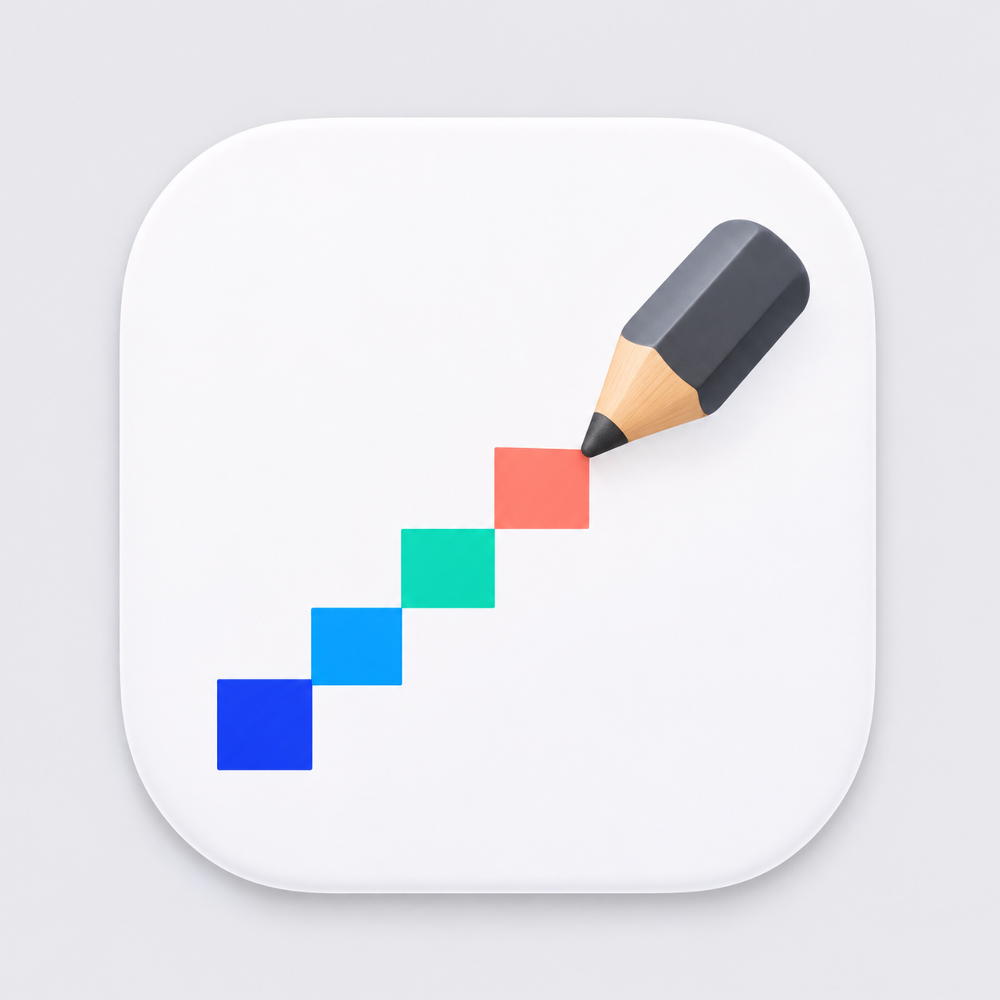

# 顺手画板



仅 macOS 的 Swift + AppKit 画板，零第三方依赖。当前面向 Apple Silicon Mac，最低 macOS 14。

## 运行

从 [GitHub Releases](https://github.com/GundamDr1ver/shunshou-board/releases/latest) 下载 Apple Silicon 安装包，解压后将 `顺手画板.app` 放入应用程序目录并打开。更新时先保存并退出旧版。

从源码构建：

```sh
zsh scripts/build.sh
```

需要 Xcode 开发工具。构建产物为本机架构，使用本地临时签名，尚未公证。源码也可使用 Xcode 打开 `Package.swift`。

## 使用

- 工具栏包含框选、画笔、橡皮、直线、箭头、矩形、圆形、三角、文字；“画笔几何模式”可一键开启。没有单独的像素工具。
- App 与 `.sboard` 文件使用已选定的像素铅笔图标，包含 16–1024 px 各尺寸；保留所选原图外观。
- 工程 `.sboard` 支持 Finder 空格预览，读取包内已有 `preview.png`；旧工程无需重存。将应用保留在应用程序目录，供系统调用预览扩展。
- 顶部为三行；第二行在“吸附”之后依次放置取色、颜色、最近颜色。
- 在画布拖动绘制。新内容保持选中，可以拖动、用方向键微调，拖右下角方块或输入 W/H 改尺寸。文字在工具栏输入，字体按钮调用系统字体面板。颜色和字体调整不结束对象编辑。
- Enter 确认并烘焙；Esc 取消。点其他空白位置、切层、创建下一个对象会先烘焙。手绘每一笔也遵循这一规则；画笔继续落下一笔会直接画，要移动或缩放刚画的笔迹，先切到“框选”。切换工具栏或临时切到其他 App 不烘焙。
- 粘贴直接进当前层。文件拖到画布进当前层；拖过图层列表时，悬停行显示目标高亮，松开后图片进入该层，并切换到该层和画布焦点。锁定或隐藏的目标层会提示拒绝。菜单“添加图片”每次询问目标层。
- 图层从上到下显示；拖拽行改变顺序，Command 点击多选。选中多个图层时，侧栏仅“新建”“删除”可用，批量删除可一步撤销。只有单选能复制、重命名或合并到下层。最后一层删除时清空。背景色、背景不透明度和整层不透明度独立。
- 层名过长以省略号显示，列宽跟随可视区，锁定按钮固定在行右侧；悬停约 0.25 秒弹出完整名称。按钮分两排，第一排新建/删除/复制，第二排重命名/合并↓。
- 框选后，普通剪切/复制操作可见合成结果；加 Shift 只操作当前层。锁定层可被复制；穿透剪切涉及锁定层时整次拒绝。剪切会清除参与层选区内的像素及背景，隐藏层保持不变。
- 复制不会烘焙。剪切当前对象时保留其对象类型，以局部裁空记录删除区域，不把对象提前转成位图。
- 按住鼠标右键拖动画布平移，不改变文档内容。Command + 滚轮围绕鼠标位置缩放，触控板捏合也可缩放。
- 画布右边、下边和右下角可双向拖拽改尺寸。拖动时只显示虚线目标边框，松开后生效；向内缩小时直接裁掉所有层超出部分（包括隐藏或锁定层），可一步撤销。Esc 可取消尺寸拖拽。“编辑 → 裁剪到选区”仍是独立命令。
- 标尺位于上边和右边。Shift 按住吸附到指定图像像素间距，默认 10 px；工具栏“⇧吸附”可修改间距，标尺和状态栏立即更新，缩放不改变单位。十字线与冻结交点仅作显示辅助。
- 放大到 800% 及以上自动显示单像素网格，此时画笔/橡皮逐格编辑当前层的单个像素，保留所选颜色透明度；每次按下至松开为一步撤销。缩小后恢复普通画笔。此操作不会创建新图层；旧工程里的普通层全部保留。
- 放大图片采用最近邻采样；1 px 普通画笔/橡皮也对齐像素中心。像素网格、选区/对象边框、尺寸预览、十字线使用独立覆盖层，替换边框路径不把旧边框写进图片。
- 十字线用 Command + R 开关，Shift + Command + R 停止/恢复跟随；不再提供冻结按钮。移动十字线不请求图片重绘，也不写入图层或导出图片。
- 颜色面板、屏幕取色和实际使用过的颜色会进入“最近颜色”，最多 12 项，跨启动保存。点击色块可重新使用。
- JPEG 不支持透明，导出时使用白底；PNG 保留透明。

## 快捷键

| 操作 | 快捷键 |
|---|---|
| 新建 / 打开 / 保存 | ⌘N / ⌘O / ⌘S |
| 工程另存为 / 添加图片 | ⇧⌘S / ⌘I |
| 导出 PNG / JPEG | ⌘E / ⇧⌘E |
| 撤销 / 重做 | ⌘Z / ⇧⌘Z |
| 可见合成剪切 / 复制 | ⌘X / ⌘C |
| 仅当前层剪切 / 复制 | ⇧⌘X / ⇧⌘C |
| 粘贴 / 全选 | ⌘V / ⌘A |
| 裁剪到选区 | ⇧⌘K |
| 对象确认 / 取消 | Enter / Esc |
| 对象微移 / 按吸附间距微移 | 方向键 / Shift + 方向键 |
| 十字线开关 / 冻结跟随 | ⌘R / ⇧⌘R |
| 标尺开关 | ⌥⌘R |
| 缩放 / 实际像素 / 适合窗口 | ⌘+、⌘− / ⌘0 / ⌘9 |
| 鼠标位置缩放 / 平移画布 | ⌘ + 滚轮 / 右键拖动 |
| 新建层 / 复制层 / 合并到下层 | ⇧⌘N / ⌘J / ⌘M |

## 工程文件

`.sboard` 是 Finder 中显示为单文件的目录包，应用包已声明 UTI 和双击打开关联。工程内含 `preview.png`、版本及尺寸 `Info.plist`、`layers/manifest.json`、各层 `0.png` 等。PNG 只保存该层内容，背景、透明度、显隐、锁定和背景裁空区由 manifest 保存。

打开先解析清单和图片头，层像素按需解码。保存采用同目录暂存包和原子替换，编码在后台执行；像素未变化的层复用原 PNG，即使只改层名或透明度也不重新编码。保存期间暂时拒绝文档修改，避免异步保存丢失新操作。只保存已烘焙像素，不保存撤销历史。

## 实现与验证

- 每层采用 256 × 256 稀疏像素块，编辑只复制受影响块，撤销共享其余不可变图像。
- 当前对象统一管理选择、移动、缩放和删除；按对象类型绘制，烘焙写回目标层。
- 每层背景与像素的合成按块缓存，局部绘图只请求局部区域；未变化层保持缓存。
- 已加载工程通过临时文件保留原 PNG，避免本应用后续保存覆盖延迟读取和撤销需要的数据。
- 测试包含真实 sRGB 像素断言、分层剪切、锁定原子性、对象生命周期、菜单快捷键分发、当前层像素编辑、画布裁切、图层拖排/多选、颜色历史、缩略图合并刷新和覆盖层离屏渲染。

```sh
swift test --disable-sandbox
```

性能数据与测试边界见 [docs/VALIDATION.md](docs/VALIDATION.md)。功能实现按用户 v3 范围进行，AI、智能剪贴板、图层组、混合模式和烘焙后对象编辑均不包含。

参考：[Paintbrush](https://paintbrush.sourceforge.io/)、[Pinta](https://github.com/PintaProject/Pinta)、[Krita](https://invent.kde.org/graphics/krita)。仅参考交互与设计，未引入第三方代码或依赖。

## 许可证

[MIT](LICENSE)。
